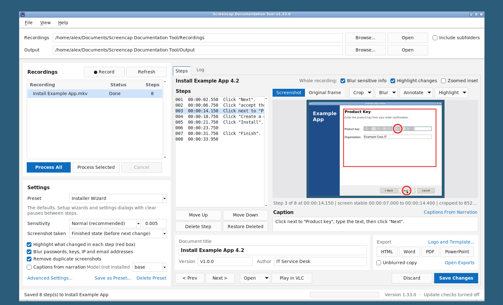
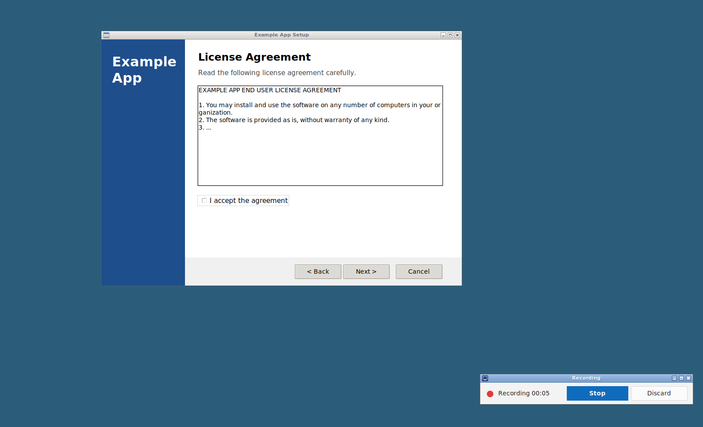
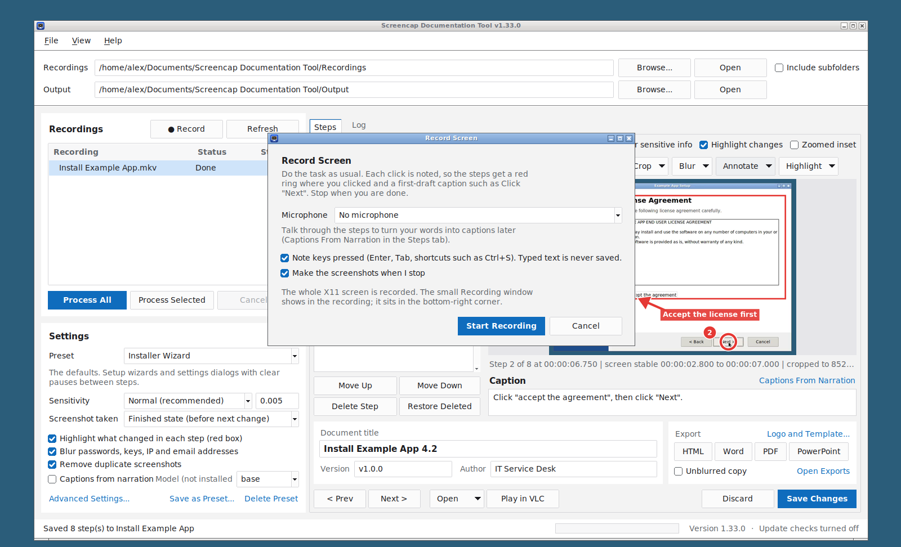
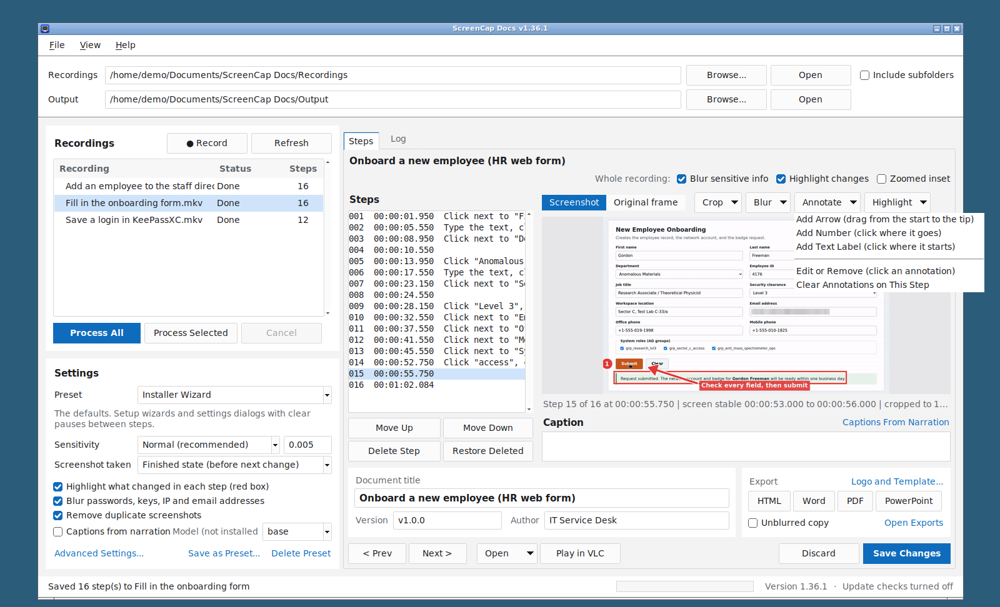
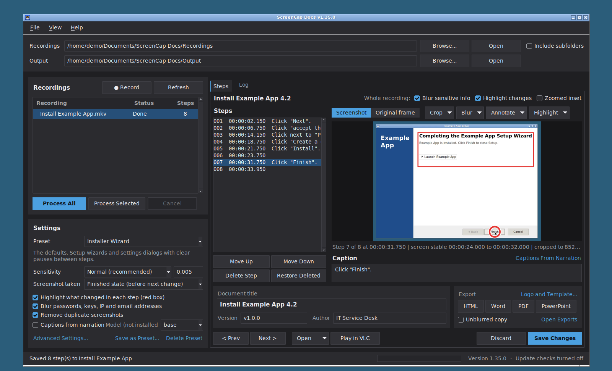
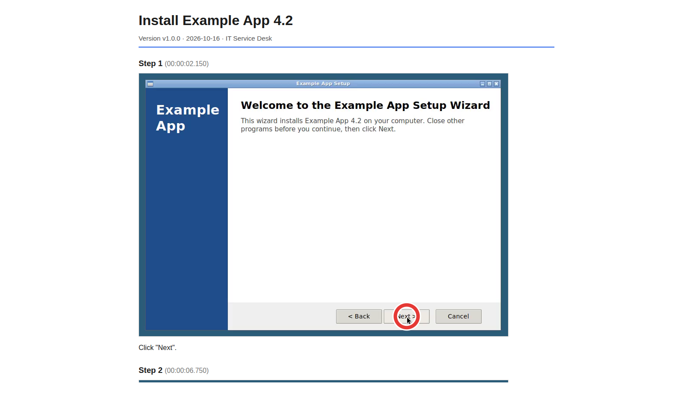
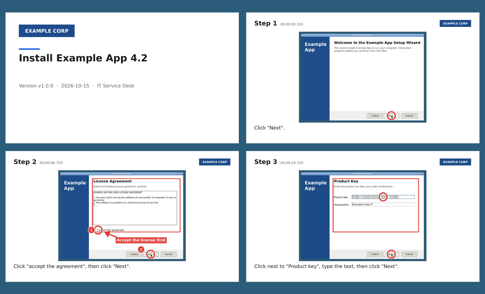
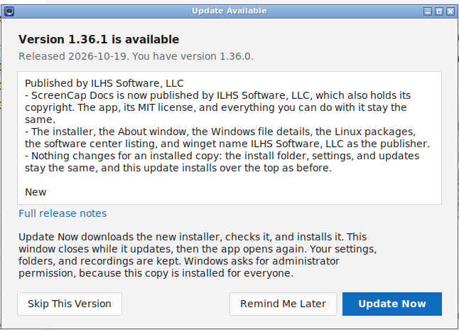

README.md v1.48.0 (Last Rev: 2026-10-16)

# ScreenCap Docs

[](#linux)
[](https://github.com/ILikeHostingServices/Screencap-Documentation-Tool/releases/latest)
[](#macos)
[](https://scorecard.dev/viewer/?uri=github.com/ILikeHostingServices/Screencap-Documentation-Tool)



## Overview

ScreenCap Docs was called **Screencap Documentation Tool** until v1.35.0. Only the name shown changed: the repository, the winget package `ILHS.ScreencapDocumentationTool`, the Linux and Homebrew package names, the Windows install folder, the program file `Screencap Documentation Tool.exe`, and the `screencap` and `screencap-gui` commands keep their names, so updates, scripts, taskbar pins, and application allow-lists keep working.

**A free Steps Recorder replacement for Windows, Linux, and macOS.** Click **Record**, install or configure a program as usual, click **Stop**, and this tool pulls out a screenshot of every step for you, marks where you clicked, and writes a first draft of each step's caption. Recordings from any other recorder work too. No more scrubbing through video to find the right frames.

Microsoft deprecated Windows' built-in Steps Recorder (`psr.exe`) in 2023: it gets no more updates and is to be removed in a future Windows release. This tool does the same job and more: full resolution screenshots, captions, arrows and labels, automatic blurring of passwords and keys, and finished HTML, Word, PDF, or PowerPoint documents. See [Coming From Steps Recorder](#coming-from-steps-recorder).

For each recording you get:

- One full resolution screenshot per step, numbered in order.
- A built-in screen recorder that notes every click and key: each step gets a red ring where you clicked and a first-draft caption such as `Click "Next".` or `Click next to "User name", type the text, then press Tab.` Typed text is never saved.
- A `steps.md` file listing every step with its timestamp, its screenshot, and its caption, ready to turn into documentation.
- Passwords, license keys, tokens, and IP and email addresses blurred automatically, with an unblurred copy kept alongside in case you need the details.
- A red box around what changed since the previous step, so readers see where to click or what appeared.
- Duplicate screenshots (for example when you go back to a screen you already captured) are removed automatically, and can be restored.
- Adjustable cropping, for the whole recording or one step, by dragging a rectangle on the picture.
- A step editor in the GUI to remove, reorder, and caption steps.
- Annotations: draw arrows, numbered markers, and text labels on any screenshot to point readers at the right button.
- An optional zoomed inset that shows a small change (a ticked checkbox, a short field) up close in a corner of the screenshot.
- Animated GIF clips of single steps, for actions a still picture cannot show well, such as dragging or a menu that opens on hover.
- Accessible documents: every screenshot gets alt text (the step number, its caption, and any labels drawn on it), so screen readers can describe it.
- A clean GUI with light and dark themes that can follow the system setting.
- Saved presets: built-in settings for installer wizards, general desktop use, web consoles, terminals, remote desktops, forms, slideshows, video meetings, and fast clicking, plus your own.
- **Play in VLC** opens the recording a few seconds before any step, to see exactly what was clicked or typed.
- Optional **Captions From Narration**: if you talk while you record, what you said becomes the first-draft caption of each step. Speech recognition runs offline on your PC.
- One-click export to a finished document: HTML (a single file with the images inside), Word, PDF, or a PowerPoint presentation (one slide per step, narration in the speaker notes), each with a title, version, date, and author header, and optionally your company logo and Word template. Every original frame is kept, so nothing you do in the editor is permanent.

You can run it from a desktop GUI or from the command line. Both use the same engine and produce the same output. It works with `.mp4`, `.mov`, and `.mkv` recordings and runs on Windows 11 (the primary target), Linux, and macOS. It needs Python 3.8+ and [FFmpeg](https://ffmpeg.org/), plus the optional [Tesseract OCR](https://github.com/tesseract-ocr/tesseract) for automatic blurring and [Pandoc](https://pandoc.org/) for Word export. PDF export uses Microsoft Edge (included with Windows 11) or Google Chrome/Chromium. All are free and open source, and the installers set them up for you.

### Screenshots

| | |
| --- | --- |
|  |  |
| **Record** the task: every click is noted. | Choose a microphone for narration, or none. |
|  |  |
| Add arrows, numbers, and labels. | Light, dark, or the system's theme. |
|  |  |
| Export the steps as one HTML, Word, or PDF document. | Or as a PowerPoint presentation, one slide per step. |

The screenshots show a made-up "Example App" setup wizard recorded with the built-in recorder; `packaging/screenshots/make_screenshots.sh` makes them again (see [Files](#files)).

### Coming From Steps Recorder

Steps Recorder watched your mouse and keyboard and took a small screenshot at every click. This tool records a video of the screen while it notes your clicks and keys the same way (see [Recording The Screen](#recording-the-screen)), then finds the steps in the video itself. It also works with recordings made by any other recorder (see [Recording Tips For Best Results](#recording-tips-for-best-results)).

| Steps Recorder | ScreenCap Docs |
| --- | --- |
| Start Record, do the task, Stop Record | **Record**, do the task, **Stop**: the screenshots are made straight away. Recordings from Snipping Tool, OBS Studio, or any other recorder work too |
| A compressed screenshot at every click | A full resolution screenshot of every step, taken when the screen settles; duplicates are removed |
| A green outline around what was clicked | A red ring where you clicked, a red box around what changed, an optional zoomed inset, and arrows, numbers, and labels you add |
| Auto-written text ("User left click on "Next (button)" in "Setup"") | A first draft in plain words (`Click "Next".`), a first draft from what you said while recording ([Captions From Narration](#captions-from-narration)), or your own captions |
| Every key you typed could end up in the file | Keys such as Enter, Tab, and Ctrl+S are noted by name; typed text is never saved |
| Comments | Captions and text labels on the screenshot |
| Saved as a `.zip` holding an `.mht` web archive, best viewed in Internet Explorer | HTML (one self-contained file), Word, PDF, or PowerPoint, with your logo and Word template, plus `steps.md` |
| Everything on screen was recorded, passwords and keys included | Passwords, keys, tokens, and addresses are blurred automatically (an unblurred copy is kept separately) |
| Windows only | Windows 11 (x64 and ARM), Linux (including Raspberry Pi), and macOS |
| A short animation was not possible | An animated GIF clip of any step |

### How It Finds The Steps

Think of it like monitoring that alerts on state changes instead of polling on a timer: rather than grabbing a frame every N seconds, the tool only takes a screenshot when the screen actually changes state.

1. **Detect changes.** FFmpeg samples the video (5 frames per second at 640 px wide, which keeps it fast) and scores how different each frame is from the one before. A score above the sensitivity threshold counts as a change.
2. **Group bursts.** Changes that happen close together, like typing, a window animating open, or a fade, are merged into a single change. You get one screenshot per step, not twenty.
3. **Capture the step.** The stable stretch between two changes is one step. By default the screenshot is taken just before the next change starts, so each step is shown finished: fields filled in, progress bar complete, mouse on the button about to be clicked. Screenshots come from the original video at full resolution.
4. **Box what changed.** Each screenshot is compared with the previous step's, and a red box is drawn around the area that changed. A whole-screen change (a new window) gets no box, and small changes far from the main one, typically the mouse cursor, are left out.
5. **Drop duplicates.** Each screenshot is compared with the ones already kept. If it is virtually identical to one of them (you went back to a screen you already captured), it is set aside as a deleted step you can restore.

## Files

| Path | Purpose |
| --- | --- |
| `Run-Screencap-GUI.bat` | Double-click to start the GUI on Windows. |
| `Run-Screencap.bat` | Double-click to run the command line version on Windows. Passes any arguments through to `screencap.py`. |
| `install.ps1` | One-step Windows installer used by the Quick Start command. |
| `install.sh` | One-step Linux and macOS installer used by the Quick Start commands. |
| `packaging/linux/` | Linux packages: `stage.sh` (the shared install layout), `build_packages.py` (.deb and .rpm with nfpm), the menu entry, the software center details, and `make_repos.sh` with `repo_index.html` (the signed apt and dnf repositories on GitHub Pages). |
| `packaging/homebrew/` | The Homebrew formula generator (`make_formula.py`), its test (`test_formula.sh`), and the files of the `ILikeHostingServices/homebrew-tap` repository (`tap/`). |
| `packaging/aur/` | The Arch Linux PKGBUILD (AUR) template and its generator. |
| `snap/snapcraft.yaml` | The snap package (Snap Store). |
| `packaging/screenshots/` | Makes the screenshots in `docs/screenshots/` (README, Linux software centers, Snap Store): `make_screenshots.sh` records a made-up setup wizard (`demo_wizard.py`) with the built-in recorder on a virtual display and takes the GUI pictures (`gui_shots.py`). Linux only; needs Xvfb, openbox, xdotool, ImageMagick, and Chromium. |
| `docs/screenshots/` | The screenshots of the app. |
| `docs/SECURITY_FOR_IT.md` | For IT and security teams: network use, files and settings, administrator controls, behaviors security tools may notice, and how to verify a download. |
| `docs/BRANDING.md` | The brand rules: the name, voice, colors, type, icon, screenshots, release notes format, and the brand check before each release. |
| `Install-Prerequisites.ps1` | Installs Python 3 and FFmpeg with `winget` if they are missing, for the current user or (with `-Scope machine`) all users. Called by `install.ps1`. |
| `theme.py` | The GUI's light, dark, and system themes. |
| `screencap_gui.pyw` | The GUI (Tkinter, included with Python). |
| `screencap.py` | The detection engine and command line tool. |
| `stepdoc.py` | The step document: loads and saves `steps.json`, renders screenshots from the originals, and writes `steps.md`. |
| `gui_editor.py` | The GUI's Steps tab (step editor). |
| `version.py` | The release version of the tool as a whole, shown in the GUI title bar and footer and by `screencap.py --version`. |
| `gui_help.py` | The GUI's Help menu: built-in help, the About window, the update check, and the update window (Update Now). |
| `updates.py` | Project links, the update check (asks GitHub for the newest release), and Update Now (downloads the installer, checks its SHA-256 checksum, and runs it silently). |
| `presets.py` | Built-in and saved presets (named sets of settings), shared by the GUI and `--preset`. |
| `player.py` | Opens the recording in VLC media player at a given moment. |
| `export.py` | Exports steps to HTML, Word (via Pandoc), PDF (via a headless Edge, Chrome, or Chromium), or PowerPoint (via `pptxwriter.py`). |
| `pptxwriter.py` | Writes PowerPoint presentations (.pptx) with the Python standard library only. |
| `tests/ooxml/` | A small checker that runs exported presentations through Microsoft's Open XML SDK (the rules Office uses); CI runs it. |
| `redact.py` | Finds sensitive text to blur, using Tesseract OCR and a list of patterns. |
| `transcribe.py` | Captions From Narration: pulls the audio out with FFmpeg, runs the speech recognition, and matches each sentence to the step that was on screen. |
| `apppaths.py` | Decides where the program and its default `source` and `output` folders live, for the Python install and for the packaged Windows app. |
| `packaging/` | Recipe for the packaged Windows app: `screencap.spec` (PyInstaller) and `make_version_info.py` (the version shown in the .exe file's Properties), `installer.iss` (the Windows installer, built with Inno Setup), and `winget/` with `make_winget_manifests.py` (the Windows Package Manager listing). |
| `whisper_worker.py` | Runs the speech recognition (faster-whisper) in the optional `whisper-env` Python environment. |
| `whisper-env/` | Optional. Created by the installer's speech recognition option (`-WithWhisper` or `SCREENCAP_WITH_WHISPER=1`). Not in git. |
| `imaging.py` | Image comparisons (duplicate detection and the "what changed" box) using FFmpeg and the Python standard library. |
| `workers.py` | Runs the per-screenshot work (FFmpeg and Tesseract) on several CPU cores at once. |
| `clips.py` | Animated GIF clips of single steps, made with FFmpeg from the original recording. |
| `annotate.py` | Annotations (arrows, numbered markers, text labels, click rings): draws them and gives FFmpeg the filters that put them on the screenshot. |
| `recorder.py` | The built-in screen recorder: records with FFmpeg and notes clicks and keys with the system's own functions. |
| `gui_recorder.py` | The GUI's Record window and the small Recording window (timer, Stop, Discard). |
| `actions.py` | Uses the noted clicks and keys: gives each to its step, adds click rings, and writes first-draft captions. |
| `tests/` | Automated tests, including a GUI test that drives the real window. See [Automated Testing](#automated-testing). |
| `ROADMAP.md` | Ideas on hold until they have been discussed further. |
| `assets/` | Application icon (`icon.ico` for Windows, `icon.png` for Linux and macOS) and `make_icon.py`, which regenerates both from code (needs Pillow). |
| `CHANGELOG.md` | What changed in every release. |
| `LICENSE` | The MIT License: free to use, change, and share, with no warranty. See [License And Support](#license-and-support). |
| `.github/ISSUE_TEMPLATE/` | The forms used to report a problem or suggest an idea on GitHub. |
| `.github/dependabot.yml` | Has Dependabot propose updates to the GitHub Actions the workflows use (third-party actions are pinned to an exact commit). |
| `SECURITY.md` | How to report a security problem privately. |
| `CODE_SIGNING_POLICY.md` | Code signing status of the Windows programs (not signed), how to check a download, how the programs are built, and the privacy statement. |
| (not here) | Maintainer notes (owner to-do list, accounts, release runbook) are kept in a private repository of the organization. |
| `.github/workflows/ci.yml` | Runs the tests on Windows and Linux for every push and pull request. |
| `.github/workflows/codeql.yml` | GitHub CodeQL code scanning of the Python code and the workflows (pull requests, pushes to main, weekly); findings appear under the Security tab. |
| `.github/workflows/scorecard.yml` | OpenSSF Scorecard: rates the repository's security practices weekly and publishes the result (the badge at the top). |
| `.github/workflows/installers.yml` | Runs the real installers on Windows, Linux, and macOS and checks the installed tool. |
| `.github/workflows/release.yml` | Creates version tags from `.github/releases/` and publishes a GitHub release for each one, then has the newest release's Windows app built and attached. |
| `.github/workflows/build-windows.yml` | Builds and tests the packaged Windows app on a real Windows machine for every pull request, and attaches it to releases. |
| `.github/workflows/build-macos.yml` | Installs and tests the Homebrew formula on a real Mac for every pull request. |
| `.github/workflows/package-repos.yml` | Builds the signed apt and dnf repositories from the newest releases, installs from them on Debian, Ubuntu, Fedora, Rocky Linux, and openSUSE, and publishes them on GitHub Pages. Run by each release. |
| `.github/workflows/build-linux.yml` | Builds the Linux packages and tests each one on its distributions, attaches them to releases, and updates the AUR and the Snap Store. |
| `.github/workflows/winget.yml` | Tests installing each release through winget and submits it to the Windows Package Manager catalog. |
| `source/` | Default folder for your recordings. |
| `output/` | Default folder for results, one subfolder per recording. |
| `tools/ffmpeg/bin/` | Optional spot for a portable `ffmpeg.exe` and `ffprobe.exe` (see [Portable FFmpeg](#portable-ffmpeg-no-admin-rights)). |

Each run creates these files in the output folder:

| Path | Purpose |
| --- | --- |
| `source/Recording <date> <time>.mkv` | A recording made with **Record**. Next to it, `Recording <date> <time>.events.json` lists its clicks and keys (never typed text). Delete the `.events.json` file to process the recording without them. |
| `output/<video>/step_001_00-00-03.750.png` | Screenshot for each step, rendered from its original. The name holds the step number and timestamp. |
| `output/<video>/originals/` | The untouched full frames captured from the video. Never modified, so edits can always be redone. |
| `output/<video>/steps.md` | The steps in order, with screenshots, timestamps, and captions. Generated from `steps.json`. Uses the blurred screenshots. |
| `output/<video>/unredacted/` | The same screenshots without blurring, for your own reference. Only created while blurring is on. |
| `output/<video>/export/` | Exported documents (`<title>.html`, `.docx`, `.pdf`). Exports of the unblurred screenshots have `-UNREDACTED` in the name. |
| `output/<video>/steps-unredacted.md` | `steps.md` using the unblurred screenshots, marked "do not publish". |
| `output/<video>/transcript.txt` | The full transcript with timestamps, written by Captions From Narration. |
| `output/<video>/steps.json` | The step document: order, captions, deleted steps, and the settings used. This is the source of truth. |
| `output/<video>/steps.hand-edited-*.md` | Backup of `steps.md`, made automatically if you edited it by hand and then saved from the editor. |
| `output/<video>/previous-*/` | The previous results, moved here (not deleted) when a recording is reprocessed with `--force`. |
| `output/screencap.log` | Detailed log of every run. Check here first when something goes wrong. |

The GUI remembers your last folders and settings in `%APPDATA%\ScreencapDocTool\gui_settings.json` on Windows, or `~/.config/screencap-doc-tool/gui_settings.json` on Linux and macOS (outside the install folder). Delete that file to reset the GUI. Your saved presets are in `presets.json` in the same folder.

Switches worth knowing for diagnostics (the full list is in the [Command Line Reference](#command-line-reference)):

- `--dry-run` lists the steps that would be captured without saving anything.
- `-v` shows debug output on screen, including the exact FFmpeg commands.
- `--force` reprocesses recordings that already have output.

## Quick Start

Each command below is a single copy and paste. It installs the prerequisites, downloads the newest release of the tool from GitHub, and sets up launchers. Running the same command again later updates the tool and keeps your recordings and screenshots.

### Windows 11

One command works for both kinds of install. The installer checks whether PowerShell is running as Administrator and picks the scope for you:

```powershell
& ([scriptblock]::Create((irm https://raw.githubusercontent.com/ILikeHostingServices/Screencap-Documentation-Tool/HEAD/install.ps1)))
```

| Paste it into | You get |
| --- | --- |
| A normal PowerShell window | **Just you.** Python and FFmpeg are installed in your user profile, and the shortcuts go on your Start Menu and Desktop. No admin rights needed, except that Windows asks permission for the optional Tesseract OCR (used for automatic blurring), whose installer is always system-wide. Decline to skip it. Best for a single-user workstation. |
| An **Administrator** PowerShell window (right-click Start > **Terminal (Admin)**) | **Everyone on this PC.** Python and FFmpeg are installed system-wide, the shortcuts go on the All Users Start Menu and Public Desktop, and every user can save into the default `source` and `output` folders. Best for shared or lab PCs. |

The first line of the installer's output confirms which scope it chose. To choose explicitly instead, add a switch to the end of the command:

```powershell
# Just you, even from an Administrator window
& ([scriptblock]::Create((irm https://raw.githubusercontent.com/ILikeHostingServices/Screencap-Documentation-Tool/HEAD/install.ps1))) -UserOnly

# Everyone on this PC (must be an Administrator window)
& ([scriptblock]::Create((irm https://raw.githubusercontent.com/ILikeHostingServices/Screencap-Documentation-Tool/HEAD/install.ps1))) -SystemWide
```

Either way the tool goes in `C:\DATA\Tools\Screencap-Documentation-Tool`. To install somewhere else, add `-InstallDir 'D:\Tools\Screencap'` to the end of the command. Add `-NoShortcuts` to skip the shortcuts.

To pin the app to the taskbar, right-click its Start Menu entry and choose **Pin to taskbar** (or right-click the running app's taskbar button).

To add the optional speech recognition for [Captions From Narration](#captions-from-narration) (about 450 MB), add `-WithWhisper` to the end of any of these commands. It can be added later the same way.

If the installer reports that a prerequisite was not detected yet, close PowerShell, open a new window, and paste the command again. Windows only picks up newly installed programs in new windows.

### Windows App (No Python Needed)

Each release also has a packaged Windows app on the [Releases page](https://github.com/ILikeHostingServices/Screencap-Documentation-Tool/releases/latest), with `Screencap Documentation Tool.exe` (the GUI) and `screencap.exe` (the command line) and Python built in. It is an alternative to the Quick Start command for PCs where you do not want Python installed. There are two forms: an installer (from v1.16.0) and a portable zip (from v1.15.0).

The Windows programs are not code signed. See [CODE_SIGNING_POLICY.md](CODE_SIGNING_POLICY.md) for how to check a download and how the programs are built.

**Which download:** files ending in `-windows-x64-...` are for ordinary PCs (Intel and AMD). From v1.25.0 there are also `-windows-arm64-...` files for **Windows on ARM** (for example Snapdragon laptops and Surface Pro with ARM): they run natively and are faster there. The x64 files also work on Windows 11 on ARM, through Windows' built-in x64 emulation. winget and **Help > Check for Updates** pick the right one by themselves. On Windows on ARM, FFmpeg and Tesseract OCR from winget are x64 programs that run emulated (they work, a little slower), and **Captions From Narration** is not available.

**Installer (recommended):**

1. Download `Screencap-Documentation-Tool-vX.Y.Z-windows-x64-setup.exe` and `SHA256SUMS.txt` from the latest release.
2. Optional but recommended, check the download is intact: in PowerShell, `(Get-FileHash .\Screencap-Documentation-Tool-vX.Y.Z-windows-x64-setup.exe).Hash` must match the line for that file in `SHA256SUMS.txt` (ignoring upper and lower case).
3. Run it. It installs for all users in `C:\Program Files\ILHS\Screencap-Documentation-Tool` (Windows asks for admin rights). Without admin rights, choose **Install for me only** on the first page to install in `%LOCALAPPDATA%\Programs\ILHS\Screencap-Documentation-Tool` instead. When a copy is already installed, setup updates it the same way (for everyone, or for you only) without asking again; to switch, run the installer with `/ALLUSERS` or `/CURRENTUSER`. A copy from v1.16.0 or earlier (in `...\Screencap Documentation Tool`) is moved to the new folder automatically; settings are kept. If FFmpeg is not found it offers to install it with winget, and one tick also installs Tesseract OCR and Pandoc.
   - **Recordings and Output Folders** page: keep the defaults, `source` and `output` inside the install folder (for example `C:\Program Files\ILHS\Screencap-Documentation-Tool\source`; for an all-users install setup makes these two folders writable for every user, since the rest of Program Files is read-only for them), or choose your own folders (setup creates them). The app uses them from its next start; both can be changed later in the app.
4. Start the app from the Start Menu. To update, run the newer installer: it detects the installed copy and goes straight to **Ready to Update** (no license, folder, or options pages, unless FFmpeg is missing), keeping your desktop shortcut choice and the recordings and output folders chosen before. Updating from v1.23.2 or earlier asks for the folders once. To remove, use **Settings > Apps**. Uninstalling never deletes your recordings, output, or settings.

For deployment, it installs silently: `setup.exe /VERYSILENT /SUPPRESSMSGBOXES /NORESTART` installs for all users (run it elevated, for example from Intune, SCCM, or PDQ). Add `/CURRENTUSER` for a per-user install without admin rights, `/TASKS=desktopicon` for a desktop shortcut, `/DIR="D:\Apps\Screencap"` for another install folder, or `/SOURCEDIR="D:\Recordings" /OUTPUTDIR="D:\Screenshots"` for the recordings and output folders (without them, a new install uses the defaults and an update keeps the earlier folders). Silent uninstall: `"C:\Program Files\ILHS\Screencap-Documentation-Tool\unins000.exe" /VERYSILENT`.

**Portable zip:**

1. Download `Screencap-Documentation-Tool-vX.Y.Z-windows-x64-portable.zip` and `SHA256SUMS.txt` from the latest release.
2. Optional but recommended, check the download is intact: in PowerShell, `(Get-FileHash .\Screencap-Documentation-Tool-vX.Y.Z-windows-x64-portable.zip).Hash` must match the line for that file in `SHA256SUMS.txt` (ignoring upper and lower case).
3. Right-click the zip, choose **Properties**, tick **Unblock** if it is shown, and click **OK**. Then extract it anywhere, for example `C:\DATA\Tools`.
4. Install FFmpeg once if this PC does not have it: `winget install --id Gyan.FFmpeg -e`. Optional, as with the Quick Start: `winget install --id UB-Mannheim.TesseractOCR -e` (automatic blurring) and `winget install --id JohnMacFarlane.Pandoc -e` (Word export). Or put `ffmpeg.exe` and `ffprobe.exe` in `tools\ffmpeg\bin\` next to the app (see [Portable FFmpeg](#portable-ffmpeg-no-admin-rights)).
5. Start `Screencap Documentation Tool.exe`.

Differences from the Python install:

- The default `source` and `output` folders are in `Documents\ScreenCap Docs` (or `Documents\Screencap Documentation Tool` when that folder exists from an earlier version), because the app's own folder may not be writable. Any folder can still be chosen in the GUI or with `-s` and `-o`.
- The app is **not code signed** (see [CODE_SIGNING_POLICY.md](CODE_SIGNING_POLICY.md)), so Windows SmartScreen may say **Windows protected your PC** the first time. Check the checksum as above, then click **More info > Run anyway**. Some antivirus products are wary of unsigned packaged Python apps; the checksum confirms the file is the one GitHub built from this repository.
- Captions From Narration needs the Python install (`-WithWhisper`); the packaged app does not include speech recognition.
- To update the portable zip, download the new zip and replace the folder. Your settings, presets, and recordings are kept, because they live in your profile and Documents, not in the app folder.

### Linux

**Snap Store.** On any distribution with snapd (x86_64 and 64-bit ARM). FFmpeg, Tesseract OCR, and Pandoc come with it, and it updates by itself:

<a href="https://snapcraft.io/screencap-documentation-tool"></a>

```bash
sudo snap install screencap-documentation-tool
```

**Package repository.** Add the project's signed repository once, and the app installs and updates with your system's normal updates (`sudo apt upgrade`, `sudo dnf upgrade`, `sudo zypper update`). Your package manager also installs FFmpeg, Python, and Tkinter.

Ubuntu, Debian, Linux Mint, Pop!_OS, Raspberry Pi OS:

```bash
sudo install -d /etc/apt/keyrings
sudo curl -fsSLo /etc/apt/keyrings/ilhs-archive-keyring.gpg https://ilikehostingservices.github.io/Screencap-Documentation-Tool/ilhs-archive-keyring.gpg
sudo curl -fsSLo /etc/apt/sources.list.d/screencap-docs.sources https://ilikehostingservices.github.io/Screencap-Documentation-Tool/apt/screencap-docs.sources
sudo apt update
sudo apt install screencap-documentation-tool
```

Fedora, RHEL, Rocky Linux, AlmaLinux (RHEL and its rebuilds also need EPEL and RPM Fusion for FFmpeg, as in the table below):

```bash
sudo curl -fsSLo /etc/yum.repos.d/screencap-docs.repo https://ilikehostingservices.github.io/Screencap-Documentation-Tool/rpm/screencap-docs.repo
sudo dnf install screencap-documentation-tool
```

openSUSE:

```bash
sudo zypper addrepo https://ilikehostingservices.github.io/Screencap-Documentation-Tool/rpm/screencap-docs.repo
sudo zypper install screencap-documentation-tool
```

The repository metadata and the .rpm files are signed with the ILHS Package Signing key ([ilhs-archive-key.asc](https://ilikehostingservices.github.io/Screencap-Documentation-Tool/ilhs-archive-key.asc)); dnf and zypper ask once to trust it. The repository keeps the newest five releases. (Available from v1.35.0.)

**Packages.** From v1.21.0 every release has packages for the common distributions. Your package manager installs FFmpeg, Python, and Tkinter with them, and the app appears in the application menu. Recordings and output go in `~/Documents/ScreenCap Docs` by default (or `~/Documents/Screencap Documentation Tool` when that folder exists from an earlier version).

| Distribution | Install |
| --- | --- |
| Ubuntu, Debian, Linux Mint, Pop!_OS | Download `screencap-documentation-tool_X.Y.Z-1_all.deb` from the [latest release](https://github.com/ILikeHostingServices/Screencap-Documentation-Tool/releases/latest), then `sudo apt install ./screencap-documentation-tool_X.Y.Z-1_all.deb` |
| Fedora | Download `screencap-documentation-tool-X.Y.Z-1.noarch.rpm`, then `sudo dnf install ./screencap-documentation-tool-X.Y.Z-1.noarch.rpm`. Fedora's own FFmpeg cannot read H.264 (most .mp4 recordings); for those, switch to the full FFmpeg from [RPM Fusion](https://rpmfusion.org/Howto/Multimedia) |
| RHEL, Rocky Linux, AlmaLinux 9 | FFmpeg comes from RPM Fusion: `sudo dnf install epel-release && sudo dnf config-manager --set-enabled crb && sudo dnf install https://mirrors.rpmfusion.org/free/el/rpmfusion-free-release-9.noarch.rpm`, then `sudo dnf install ./screencap-documentation-tool-X.Y.Z-1.noarch.rpm` |
| openSUSE Tumbleweed | `sudo zypper install --allow-unsigned-rpm ./screencap-documentation-tool-X.Y.Z-1.noarch.rpm` (for H.264 recordings, FFmpeg from [Packman](https://en.opensuse.org/Additional_package_repositories#Packman)) |
| Arch Linux, Manjaro, EndeavourOS | Download `screencap-documentation-tool-X.Y.Z-1-any.pkg.tar.zst`, then `sudo pacman -U ./screencap-documentation-tool-X.Y.Z-1-any.pkg.tar.zst`. The AUR package is planned: it is published as soon as the AUR reopens new account sign-ups |
| Raspberry Pi OS (64-bit and 32-bit), and other ARM boards running Debian or Ubuntu | The same `.deb` as for Debian: it is not tied to a processor type, and the Pi's own Python, Tkinter, and FFmpeg are used. `sudo apt install ./screencap-documentation-tool_X.Y.Z-1_all.deb`. A Raspberry Pi 4 or 5 is recommended; processing is slower than on a PC |
| Any distribution with snapd | `sudo snap install screencap-documentation-tool` from the [Snap Store](https://snapcraft.io/screencap-documentation-tool) (x86_64 and 64-bit ARM, including 64-bit Raspberry Pi OS), or download the `.snap` for your processor (`_amd64` or `_arm64`) and `sudo snap install --dangerous ./screencap-documentation-tool_X.Y.Z_amd64.snap`. The snap brings its own FFmpeg, Tesseract, and Pandoc and can use your home folder and removable drives. Command line: `screencap-documentation-tool.cli`. On 32-bit Raspberry Pi OS use the `.deb` |

Every package is installed and tested on its distributions for every change (see `.github/workflows/build-linux.yml`), including on 64-bit ARM (Debian 12 and 13, Ubuntu 24.04, as on 64-bit Raspberry Pi OS) and 32-bit ARM (Debian 12 and 13 armhf, as on 32-bit Raspberry Pi OS), and `SHA256SUMS-linux.txt` on each release lists their checksums. Tesseract OCR and Pandoc are recommended extras (the `.deb` installs them by default; otherwise add them with your package manager). Remove a package the usual way, for example `sudo apt remove screencap-documentation-tool`.

**Install command.** Or paste this into a terminal (works on Debian/Ubuntu, Fedora, and Arch based distributions):

```bash
sudo bash -c "$(curl -fsSL https://raw.githubusercontent.com/ILikeHostingServices/Screencap-Documentation-Tool/HEAD/install.sh)"
```

This installs FFmpeg, Python 3, Tkinter, Tesseract OCR, and Pandoc with your package manager, installs the tool in `/opt/Screencap-Documentation-Tool`, and adds the `screencap-gui` and `screencap` commands plus an application menu entry. The program files are owned by root; the `source` and `output` folders belong to you, so you can use the tool without `sudo`.

### macOS

**Homebrew (recommended).** With [Homebrew](https://brew.sh) installed:

```bash
brew install ilikehostingservices/tap/screencap-documentation-tool
```

This installs the tool with Homebrew's own Python, Tkinter, and FFmpeg and adds the `screencap-gui` and `screencap` commands. To add the app to Launchpad, Spotlight, and the Dock:

```bash
ln -sf "$(brew --prefix)/opt/screencap-documentation-tool/ScreenCap Docs.app" ~/Applications/
```

Updating from v1.34.1 or earlier, where the app was called Screencap Documentation Tool: run the `ln` command again, then remove the old link with `rm ~/Applications/"Screencap Documentation Tool.app"`.

Optional extras: `brew install tesseract` (automatic blurring) and `brew install pandoc` (Word export). Update with `brew update && brew upgrade screencap-documentation-tool`. Recordings and output go in `~/Documents/ScreenCap Docs` by default (or `~/Documents/Screencap Documentation Tool` when that folder exists from an earlier version). The app is built on your Mac by Homebrew from the published source, so macOS does not block it even though it is not notarized. (Available from v1.22.0.)

**Install command.** Or paste this into Terminal as your normal user (no `sudo`):

```bash
bash -c "$(curl -fsSL https://raw.githubusercontent.com/ILikeHostingServices/Screencap-Documentation-Tool/HEAD/install.sh)"
```

This installs [Homebrew](https://brew.sh) if you do not have it (it will ask for your password), installs FFmpeg, Python, Tkinter, Tesseract OCR, and Pandoc with Homebrew, installs the tool in `~/Applications/Screencap-Documentation-Tool`, and adds the `screencap-gui` and `screencap` commands. In Finder you can also double-click `Screencap GUI.command` in that folder.

`~/Applications` is the standard macOS location for apps installed for just your user account, so no admin rights are needed after Homebrew is set up. To use a different folder on Linux or macOS, put `SCREENCAP_DIR=/your/path` in front of `bash`, for example `sudo SCREENCAP_DIR=/srv/screencap bash -c "..."`.

To add the optional speech recognition for [Captions From Narration](#captions-from-narration) (about 450 MB), put `SCREENCAP_WITH_WHISPER=1` in front of `bash` the same way:

```bash
# Linux
sudo SCREENCAP_WITH_WHISPER=1 bash -c "$(curl -fsSL https://raw.githubusercontent.com/ILikeHostingServices/Screencap-Documentation-Tool/HEAD/install.sh)"

# macOS
SCREENCAP_WITH_WHISPER=1 bash -c "$(curl -fsSL https://raw.githubusercontent.com/ILikeHostingServices/Screencap-Documentation-Tool/HEAD/install.sh)"
```

### First Run

1. Put your recordings in the `source` folder inside the install folder, or point the GUI at the folder your recorder already saves to.
2. Start the GUI (Start Menu shortcut on Windows, `screencap-gui` on Linux and macOS) and click **Process All**.
3. Clean up the steps in the **Steps** tab (delete extras, reorder, add captions) and click **Save Changes**, then click **steps.md** to open the document. VS Code, Obsidian, Typora, or any Markdown viewer shows the screenshots inline.

Prefer the command line? Run `screencap` on Linux and macOS, or `Run-Screencap.bat` in the install folder on Windows.

### Reviewing The Installer First

Piping a script from the internet straight into a shell means trusting it. To read it before running it, download it, review it, then run the local copy:

```powershell
irm https://raw.githubusercontent.com/ILikeHostingServices/Screencap-Documentation-Tool/HEAD/install.ps1 -OutFile install.ps1
notepad install.ps1
powershell -ExecutionPolicy Bypass -File .\install.ps1
```

```bash
curl -fsSL -o install.sh https://raw.githubusercontent.com/ILikeHostingServices/Screencap-Documentation-Tool/HEAD/install.sh
less install.sh
sudo bash install.sh        # macOS: bash install.sh
```

## After Install Configuration

### Using The GUI

The window is laid out in the order you use it:

1. **Folders** (top bar). **Recordings** is where recordings come from and **Output** is where results go. **Browse...** changes a folder and **Open** shows it in Explorer. Tick **Include subfolders** to scan the recordings folder recursively.
2. **Recordings** (left). **Record** (or Ctrl+R) records the screen with the built-in recorder (see [Recording The Screen](#recording-the-screen)). The list shows every recording found, with its status (New, Queued, Processing, Done, Failed, Cancelled) and step count. Click **Process All**, or Ctrl+click / Shift+click to pick several and click **Process Selected**. **Cancel** stops the run, and double-clicking a row opens its output folder.
3. **Settings** (left, below). Pick a **Preset** for the kind of recording (see [Presets](#presets)); a line under it says what it is for. **Sensitivity** (High, Normal, Low, or your own threshold) and **Screenshot taken** (the finished state of each step, or right after each change) are the settings you change most. The check boxes switch the red **highlight** box, automatic **blurring** of passwords, keys, IP and email addresses (see [Blurring Sensitive Information](#blurring-sensitive-information)), **duplicate removal**, and **Captions from narration**. **Save as Preset...** and **Delete Preset** manage your own presets.
4. **Advanced Settings...** (also in the **View** menu) opens a separate window, grouped into **Timing**, **Detection** (frames checked per second, analysis width, duplicate tolerance), **Output** (image format and extra **Also blur** patterns), and **Run** (**Reprocess recordings that are already done**, and **Dry run** to count steps without saving anything). **Reset to Defaults** puts everything back.
5. **Steps tab** (right). The step editor for the selected recording (see [Editing Steps](#editing-steps) below).
6. **Log tab.** Shows the run as it happens, with errors in red. The same log is saved to `output\screencap.log`. Ctrl+1 and Ctrl+2 switch between the tabs.
7. **Status bar** (bottom). On the left, what is happening; in the middle, the progress of a run; on the right, the version and whether it is the latest (**Up to date**, or **Update available** in orange). Click the update part to check again or to see the new version.

Drag the divider between the left side and the tabs to give either more room.

**Appearance:** **View > System Theme** (the default) follows the light or dark app setting of Windows (Settings > Personalization > Colors), macOS, or the Linux desktop, and switches when that setting changes. **View > Light Theme** and **View > Dark Theme** pick one for good. The choice is remembered.

Your folders and settings are saved when you process or close the window and restored the next time you open it.

### Recording The Screen

**Record** (above the list of recordings, or **File > Record Screen...**, Ctrl+R) records the screen the way Windows Steps Recorder did, but as a video, while it notes where you click and which keys you press.

1. Choose a **Microphone** if you want to talk through the steps (your words can become captions with [Captions From Narration](#captions-from-narration)), and whether keys are noted.
2. Click **Start Recording**. The main window minimizes and a small **Recording** window with a timer, **Stop**, and **Discard** appears in the bottom-right corner.
3. Do the task as usual, pausing a moment after each step. Click **Stop** when you are done.

The recording is saved in the Recordings folder as `Recording <date> <time>.mkv`, selected in the list, and processed straight away (untick **Make the screenshots when I stop** to do that later).

What is noted, next to the recording in `<name>.events.json`:

- Where and when you click, including double-clicks, right-clicks, and drags.
- Keys by name: Enter, Tab, Esc, Delete, the arrow and function keys, and shortcuts such as Ctrl+S.
- **Never the text you type.** Letters, digits, and punctuation only count as "type the text", including characters typed with AltGr (such as @ on many European keyboards) or with Option on a Mac. Untick **Note keys pressed** to leave keys out entirely. Administrators can switch noting keys off for everyone on a PC by setting the environment variable `SCREENCAP_NO_KEYS=1` (Group Policy, Intune, or a login script); clicks are still noted.

What it is used for:

- Each click gets a red ring on its step's screenshot, and a drag gets an arrow. They are ordinary annotations: **Annotate > Edit or Remove** takes one off.
- Each empty caption gets a first draft, for example `Click "Next".`, `Double-click "Report.docx".`, or `Click next to "User name", type the text, then press Tab.` The words of the clicked button are read from the recording at the moment of the click with Tesseract OCR, when it is installed. Words that look sensitive (the same patterns that are blurred) are left out, and without Tesseract the caption says "the marked spot".
- Captions you type are never changed. **Captions From Narration** replaces a first draft you have not edited, since your own words usually say more.

By system:

- **Windows:** all monitors are recorded, at their full resolution. The small Recording window is left out of the video (Windows 10 version 2004 and later).
- **macOS:** the main display is recorded. The first time, macOS asks to allow the app (or Terminal, for the Python install) under **System Settings > Privacy & Security > Screen Recording**, and **Input Monitoring** for keys. Restart the app after allowing it.
- **Linux:** the whole screen of an X11 session is recorded. Wayland sessions do not let other programs record the screen or see clicks: choose an "on Xorg" or "X11" session at the login screen, or record with the desktop's own recorder (GNOME: Ctrl+Shift+Alt+R) and put the file in the Recordings folder. The Recording window shows in the video there, in the bottom-right corner. In the snap, connect the microphone once with `sudo snap connect screencap-documentation-tool:audio-record`.

On the command line, `screencap --record` records until you press Enter and then processes the recording (see the [Command Line Reference](#command-line-reference)).

### Help Menu And Update Checks

The **Help** menu (or F1) has:

- **Help** and **Keyboard Shortcuts**: short built-in guides to getting started, presets, editing, blurring, exporting, and troubleshooting. **Online Documentation** opens this README.
- **Report a Problem...** and **Suggest an Idea...**: open the matching form on GitHub. **About** shows the version, the system, and each helper program on its own line (a green check mark when it is installed, a red cross when not, and what it is for), and can **Copy Details** (the same information as text, without any folder paths) to paste into the form.
- **Project on GitHub** and **Release Notes**.
- **Check for Updates...**: asks GitHub whether a newer release is out and, if so, shows what changed and how to update this copy.
- **Check for Updates Automatically**: the first time the GUI starts it asks whether to do this; when on, it checks at most once a day, in the background. **Skip This Version** in the update window stops the reminders for that version.

**Update Now (Windows installer).** On a copy installed with the Windows installer, the update window has an **Update Now** button. It downloads the new installer for your PC (x64 or ARM64) from this project's GitHub release, checks it against the release's `SHA256SUMS.txt` (a damaged or altered download is deleted and never run), closes the app, installs the update silently for the same scope (just you, or everyone on the PC), and opens the app again. Your settings, presets, folders, and recordings are kept. A copy installed for everyone needs administrator rights, so Windows shows its permission prompt. Other copies show the update command to copy (Homebrew, apt, dnf, the AUR, snap) or open the download (the portable zip). Snaps also update by themselves.



The update check only asks GitHub for the public list of releases, the same as opening the Releases page in a browser; nothing about the PC or your files is sent. **Update Now** downloads only from this project's own GitHub release files. To turn update checks and Update Now off for everyone on a PC (for example in a managed environment where updates are deployed centrally), set the environment variable `SCREENCAP_NO_UPDATE_CHECK=1` with Group Policy, Intune, or a login script.

### Editing Steps

Select a processed recording in the **Recordings** list and the **Steps** tab shows its steps.

| Control | What it does |
| --- | --- |
| Step list | Every step with its time and caption. **< Prev** / **Next >**, or the **Up** and **Down** arrow keys, page through them. The arrow keys work anywhere in the Steps tab except while typing a caption or title. |
| **Move Up** / **Move Down** (or **Ctrl+Up** / **Ctrl+Down** in the list) | Change the order of steps. The step you move stays selected, so the picture keeps showing it; the status bar says where it moved to. |
| **Delete Step** (or the Delete key) | Remove a step. Its original frame is kept. |
| **Restore Deleted** | Put every deleted step back at its place in the video's timeline. |
| **Screenshot / Original frame** | Preview the step as it will be saved, or the untouched frame from the video. |
| **Crop** menu | **Crop All Steps** or **Crop This Step Only**: drag a rectangle on the picture around the area to keep (Esc cancels). **No Crop on This Step** leaves the selected step uncropped even when the recording has a crop. **Clear All Crops** removes every crop. |
| **Blur** menu | **Add Blur Box**: drag a rectangle around anything else to blur. **Un-blur / Re-blur**: click a blur box on the picture; a detected box is switched off (gray outline) or back on, a hand-drawn box is removed. **Blur This Step** switches blurring for the selected step only. **Re-scan All Steps for Sensitive Text** detects sensitive text again on every step and saves, for example after installing Tesseract (hand-drawn boxes are kept). |
| **Annotate** menu | **Add Arrow**: drag from where the arrow starts to what it points at. **Add Number**: click to place a numbered marker (1, 2, 3, ... in the order you add them). **Add Text Label**: click where the label goes and type its text. **Edit or Remove**: click an annotation to change its text or number, or to remove it (an empty label or the number 0 removes it). **Clear Annotations on This Step** removes them all. Annotations are drawn on top of everything else, including the blur, so they never reveal what is blurred. |
| **Highlight** menu | **Red Box on This Step** turns the red "what changed" box on or off for the selected step only. **Zoomed Inset on This Step** does the same for the zoomed inset. Both override the recording-wide setting. **Animated Clip of This Step (GIF)** adds a short animation of the step (see below). |
| **Whole recording: Blur sensitive info / Highlight changes / Zoomed inset** (top right) | Turn blurring, the red box, or the zoomed inset on or off for the whole recording. The **zoomed inset** is a magnified copy (up to 2.5 times) of a small change, such as a ticked checkbox or a short field, placed in the corner of the screenshot farthest from it, so it stays readable when the document shows the screenshot small. Steps where the change is already big enough to read, or where nothing changed, get no inset. It is made from the blurred screenshot, so it never shows anything that is blurred. |
| **Caption** | The text shown under the step in `steps.md` and in exports, replacing the `_Notes:_` placeholder. It is also the screenshot's alt text (with the step number and the text of any labels), which screen readers read aloud. |
| **Document title / Version / Author** | The header of exported documents. The title defaults to the recording's name and the version to `v1.0.0`; the date is the day you export. |
| **Export: HTML / Word / PDF / PowerPoint** | Save the steps as a finished document in `export/` and open it (see [PowerPoint Presentations](#powerpoint-presentations)). Unsaved edits are saved first. **Unblurred copy** exports the unblurred screenshots instead (asks for confirmation; the file name gets `-UNREDACTED` and a warning). **Open Exports** opens the `export/` folder. **Logo and Template...** chooses a company logo and a Word template used for every export (see [Logo And Word Template](#logo-and-word-template)). |
| **Open** menu | Open the screenshot, `steps.md`, the recording's output folder, or the exports folder. |
| **Play in VLC** | Open the original recording in VLC 3 seconds before the selected step's screen appeared, so you can watch the click or keystroke that led to it. Needs [VLC](https://www.videolan.org/) and the recording still in its source folder. |
| **Captions From Narration** | Fill the empty captions from what was said in the recording (see [Captions From Narration](#captions-from-narration)). |
| **Save Changes** | Re-render the screenshots from the originals and regenerate `steps.md` and `steps.json`. |
| **Discard** | Go back to the last saved version. |

On **Original frame**, dashed outlines show what will be applied: blue for the crop, red for the "what changed" box, yellow for detected sensitive text (gray when switched off), and orange for hand-drawn blur boxes. Annotations are shown as red outlines there, and finished on **Screenshot**. Annotation sizes follow the recording's resolution, so they look the same in a 1080p and a 4K recording. Their text uses a bold system font (Segoe UI on Windows, Arial on macOS, DejaVu Sans or another sans-serif font on Linux); set `SCREENCAP_FONT` to the path of a `.ttf` file to use a different one. The drawn arrows and markers are kept in an `overlays` folder next to the screenshots. Cropping only affects the rendered screenshots: the frames in `originals/` are never changed, so a crop can be adjusted or removed at any time.

#### Animated Clips

For a step a still picture cannot show well, such as dragging something, a menu that opens on hover, or a slider, tick **Highlight > Animated Clip of This Step (GIF)** and click **Save Changes**. The clip runs from just before the screen changes until the next screen has settled (at most 6 seconds), at 10 frames per second and up to 960 pixels wide. It goes in `clips/` and appears under the step's screenshot in `steps.md` and in HTML and Word exports (Word plays animated GIFs; PDF shows the first frame). **Open > Open Animated Clip** opens it.

Clips are made from the original recording, so it must still be in its source folder when you save. They are cropped like the screenshot and blurred with the blur boxes of this step and the next one. The clip also shows the moments in between, so before sharing, play the clip of any screen with sensitive information. The red box, the zoomed inset, and annotations are not drawn on clips.

#### PowerPoint Presentations

**PowerPoint** in the Export box (command line: `--export pptx`) saves the steps as a widescreen (16:9) presentation, for training sessions and handovers:

- A title slide with the document title, version, date, author, and your logo.
- One slide per step: "Step N" with its time in the recording, the screenshot as large as fits, and the caption under it. Long captions get a smaller font.
- The screenshot's alt text, for screen readers, as in the other exports.
- What was said during the step (from [Captions From Narration](#captions-from-narration)) in the slide's **speaker notes**, so the presenter has the script.
- A step with an animated clip gets one more slide with the clip, which plays in the slide show.
- Your logo (PNG, JPG, or GIF; PowerPoint cannot show an SVG logo) in the corner of every slide.

No other program is needed: the presentation is written by the tool itself and opens in PowerPoint, Keynote, LibreOffice Impress, and Google Slides. The **Unblurred copy** option works as for the other exports and puts the warning on the title slide.

#### Logo And Word Template

Click **Logo and Template...** in the Export box to make exports look like your own documents. Both are remembered and used for every export until you clear them.

- **Logo**: a PNG, JPG, GIF, or SVG picture shown at the top of HTML, PDF, and Word exports, next to (HTML, PDF) or above (Word) the title, and on every PowerPoint slide (except an SVG logo).
- **Word template**: a Word document whose look is copied into Word exports: the fonts, colors, and spacing of its styles (Title, Heading 2 for the step headings, Normal for captions), its margins and page size, and its page header and footer. Word's own templates (`.dotx`) are not used directly; save a `.docx` instead.
- **Create Starter Template...** saves the standard template (it needs Pandoc). Open it in Word, change its styles (right-click a style in the Styles gallery, then **Modify**) and add your logo or a confidentiality note to the page header or footer, save it, and choose it as the Word template. Leave the text in it alone: only its styles, page layout, header, and footer are used.

On the command line, use `--logo`, `--word-template`, and `--create-word-template` (see [Command Line Reference](#command-line-reference)).

Nothing is written until you click **Save Changes**. If you switch recordings, start processing, or close the window with unsaved changes, the GUI asks whether to save them first.

`steps.md` is generated from `steps.json`, so write captions in the editor rather than in `steps.md`. If you do edit `steps.md` by hand and then save from the editor, your edited copy is kept as `steps.hand-edited-<date>-<time>.md` next to it.

Output from v1.4.0 and earlier is upgraded automatically the first time you open it: the screenshots move into `originals/` and the old `steps.md` is kept as `steps.pre-upgrade-<date>-<time>.md`.

### Presets

A preset is a named set of the Detection Settings. Pick one from **Preset** above Detection Settings and every setting is filled in; settings the preset does not mention go back to their defaults.

| Built-in preset | Use it for | What it changes |
| --- | --- | --- |
| **Installer Wizard** | Setup wizards and settings dialogs with clear pauses (the default) | Nothing; the recommended defaults |
| **General Desktop Use** | Moving around the operating system: opening apps, browsing files in File Explorer, and flipping through menus | Slightly more sensitive with shorter waits, so quick menu changes are caught. **No blurring and no red boxes**: screenshots are saved exactly as captured |
| **Web Console** | Admin portals and web apps | Ignores spinners and slow-loading pages: less sensitive, waits longer for the screen to settle |
| **Terminal / Command Line** | Shells and consoles | Catches small text changes and analyzes at full resolution; merges bursts of typing |
| **Remote Desktop / VM Console** | RDP, VNC, Hyper-V, VMware, and other remote or virtual machine consoles | Ignores compression noise and waits longer for a slow screen to finish drawing |
| **Forms and Spreadsheets** | Filling in forms, tickets, and spreadsheets | Catches small field changes and merges a whole entry being typed into one step |
| **Slideshow / Presentation** | Slide decks and click-through demos | One screenshot per slide, no forced shots on slides shown for a long time. No blurring and no red boxes |
| **Video Meeting / Screen Share** | Recorded calls and shared screens (Teams, Zoom, Meet) | Much less sensitive, so webcam and video movement do not count as steps; analyzes fewer frames. Blurring stays on (names and email addresses), no red boxes |
| **Fast Clicking** | Recordings with short pauses between actions | Shorter waits, and analyzes more frames per second |

The presets are starting points: if a recording gets too many or too few screenshots, adjust **Sensitivity** and save the result as your own preset.

To save your own, adjust the settings (including **Also blur** patterns), click **Save as Preset...**, and give it a name, for example `Customer portal`. **Delete Preset** removes a saved preset (built-in presets cannot be deleted). Saved presets are stored in your profile and can be used on the command line too (preset names are not case-sensitive, so `--preset "web console"` works as well):

```powershell
py -3 .\screencap.py --list-presets
py -3 .\screencap.py --preset "Web Console"
py -3 .\screencap.py --preset "Customer portal" --force    # options you add override the preset
```

### Tuning For Your Recordings

The defaults are tuned for typical setup wizards. If a recording gives you too many or too few screenshots, do a dry run first so you can experiment without writing files (GUI: tick **Dry run**; command line: `--dry-run`), then adjust:

| Problem | GUI setting | Command line |
| --- | --- | --- |
| Too many near-duplicate screenshots (hover effects, small redraws) | Sensitivity **Low**, or raise **Merge changes within** to 2 | `--threshold 0.015` and/or `--debounce 2` |
| Missing steps (a checkbox or small text change not caught) | Sensitivity **High**, or set **Analyze width** to 0 | `--threshold 0.002` and/or `--analyze-width 0` |
| A screenshot you wanted was removed as a duplicate | Click **Restore Deleted** in the Steps tab, or lower **Duplicate if differs by (%)** (for example to 0.005), or untick **Remove duplicate screenshots** | `--dedup-threshold 0.005`, or `--no-dedup` |
| The red box is in the wrong place or not useful | Untick **Highlight > Red Box on This Step** for that step in the Steps tab, or untick **Highlight what changed in each step** before processing | `--no-highlight` |
| Screenshots show a half-drawn window | **Screenshot taken**: Finished state, or raise **Settle after change** | `--capture-point end`, or raise `--settle` |

After changing settings, reprocess with **Reprocess videos that are already done** ticked (command line: `--force`).

**Speed.** Saving the screenshots, reading clicked words, scanning for sensitive text, and rendering run on all CPU cores (up to 8 at once), so a 3-minute recording with 40 steps takes about a third of the time it did before v1.33.0. Finding the steps reads the whole video once and is limited by how fast FFmpeg decodes it. To use fewer cores (for example on a shared server), set the `SCREENCAP_WORKERS` environment variable to the number to use; `SCREENCAP_WORKERS=1` does everything one at a time.

### Recording Tips For Best Results

- The built-in **Record** button is the simplest way: it also notes your clicks for click rings and captions. See [Recording The Screen](#recording-the-screen).
- Pause for about a second after each meaningful step. The tool looks for moments when the screen is still.
- Record a single window or monitor rather than a multi-monitor desktop. If you do record several monitors, crop to the one that matters with **Crop: All Steps** in the Steps tab, or `--crop` on the command line.
- Turn on Do Not Disturb so notification popups do not show up as extra steps.
- [OBS Studio](https://obsproject.com/) (free, open source) and the built-in Windows Snipping Tool recorder both work well. In OBS, record to `.mkv`, which survives a crash mid-recording, and remux to `.mp4` if needed.

### Blurring Sensitive Information

When blurring is on (the default), each screenshot's text is read with Tesseract OCR and these are blurred automatically:

- IPv4 and IPv6 addresses, MAC addresses, and email addresses
- GUIDs (for example tenant or subscription IDs) and license or product keys such as `ABCDE-12345-FGHIJ-67890-KLMNO`
- API tokens (GitHub, Slack, AWS, Google, JWT) and other long strings that mix letters and numbers
- Masked passwords (rows of dots or asterisks)
- Whatever follows a label such as `Password:`, `Token:`, `Secret:`, `API key:`, `Serial:`, or `Product key:` on the same line
- Anything matching your own patterns in **Also blur** (GUI, separate several with `;`) or `--redact-pattern` (command line). Patterns are case-insensitive regular expressions, for example `corp\.example\.com` for an internal domain.

Blurred areas are pixelated and then blurred, so the text cannot be read back. Blurring is applied only to the screenshots used by `steps.md`. A complete unblurred set is kept in `unredacted/` with its own `steps-unredacted.md`, in case you need a detail that was blurred. Treat that folder as sensitive.

Automatic detection is a safety net, not a guarantee: OCR can misread text, and it cannot know that an ordinary-looking word is a secret. Always look through the screenshots before publishing, and use **Add Blur Box** for anything it missed. Without Tesseract installed, nothing is detected automatically, but hand-drawn blur boxes still work.

### Captions From Narration

If you talk while you record ("now I accept the license and click Next"), the tool can turn what you said into the first draft of each step's caption. It is optional and off by default.

**Install it once** by adding `-WithWhisper` (Windows) or `SCREENCAP_WITH_WHISPER=1` (Linux, macOS) to the Quick Start command. This puts [faster-whisper](https://github.com/SYSTRAN/faster-whisper), an offline version of OpenAI's Whisper speech recognition, in a separate `whisper-env` folder inside the install folder, so it never changes your system Python. The speech model is downloaded the first time it is used (about 150 MB for the default `base` model) into your user profile (`.cache\huggingface`). After that it works without an internet connection, and the audio never leaves your PC.

**Use it** in either of two ways:

- Tick **Captions from narration** in Detection Settings before processing. The Videos list shows **Transcribing** after the screenshots are saved.
- For a recording that is already processed, open it in the Steps tab and click **Captions From Narration** (next to **Caption**). Review the captions, then click **Save Changes**.

How it works:

- Each sentence goes to the step whose screen was showing while it was said. Talking about a screen before you click away from it gives the best results.
- Only empty captions are filled. Captions you typed are never replaced, so it is safe to run again.
- Each step's full narration is kept in `steps.json`, and the whole transcript, with timestamps, is saved as `transcript.txt`.
- Recordings without audio or without speech are fine; nothing is changed.

Pick the **Model** in Detection Settings (command line: `--whisper-model`). Bigger models are more accurate but slower and larger to download:

| Model | Download | Notes |
| --- | --- | --- |
| `tiny` | about 75 MB | Fastest, least accurate. |
| `base` | about 150 MB | Default. Good for clear narration. |
| `small` | about 500 MB | More accurate, roughly 3 times slower than `base`. |
| `medium` | about 1.5 GB | Most accurate here, slow without a graphics card. |

Add `.en` (for example `base.en`) for English-only models, which are a little more accurate for English. Everything runs on the CPU; no graphics card is needed.

### Keeping Sensitive Data Out Of Git

Setup recordings often capture passwords, license keys, API tokens, internal hostnames, and IP addresses. This repository is public, so `.gitignore` excludes everything in `source/` and `output/`, all video and image files, logs, and the `tools/` folder. Before you commit anything, run:

```powershell
git status --short
```

and confirm that no media, logs, or files containing secrets are listed. Also review the screenshots before publishing documentation built from them (see [Blurring Sensitive Information](#blurring-sensitive-information)), and never publish `unredacted/` or `steps-unredacted.md`.

### Updating And Uninstalling

**Update:** **Help > Check for Updates...** in the GUI says whether a newer version is out. For the Python install, paste the same Quick Start command again. It downloads the latest version over the top of the old one. Nothing in `source` or `output` is deleted, and GUI settings are kept.

**Uninstall:** move any recordings or screenshots you want to keep out of the install folder first, because removing the folder deletes them. If the Windows installer version is also installed (or you are switching to it), keep `%APPDATA%\ScreencapDocTool`: both versions share those settings and saved presets, so leave it out of the commands below.

```powershell
# Windows, just-you install
Remove-Item -Recurse -Force 'C:\DATA\Tools\Screencap-Documentation-Tool', "$env:APPDATA\ScreencapDocTool"
Remove-Item -Force "$([Environment]::GetFolderPath('Programs'))\ScreenCap Docs.lnk", "$([Environment]::GetFolderPath('Desktop'))\ScreenCap Docs.lnk"

# Windows, everyone install (Administrator window). Each user's GUI settings stay in their own %APPDATA%\ScreencapDocTool.
Remove-Item -Recurse -Force 'C:\DATA\Tools\Screencap-Documentation-Tool'
Remove-Item -Force "$([Environment]::GetFolderPath('CommonPrograms'))\ScreenCap Docs.lnk", "$([Environment]::GetFolderPath('CommonDesktopDirectory'))\ScreenCap Docs.lnk"
```

```bash
# Linux
sudo rm -rf /opt/Screencap-Documentation-Tool /usr/local/bin/screencap /usr/local/bin/screencap-gui /usr/share/applications/screencap-documentation-tool.desktop
rm -rf ~/.config/screencap-doc-tool

# macOS
rm -rf ~/Applications/Screencap-Documentation-Tool "$(brew --prefix)/bin/screencap" "$(brew --prefix)/bin/screencap-gui" ~/.config/screencap-doc-tool
```

Python and FFmpeg are left installed because other programs may use them. Remove them with `winget uninstall`, your Linux package manager, or `brew uninstall` if you no longer need them.

### Switching A Windows PC From Just You To Everyone

Paste the Quick Start command into an **Administrator** PowerShell window. It installs system-wide copies of Python and FFmpeg (copies that only exist in one user's profile do not count, because other accounts cannot use them), moves the shortcuts to the All Users locations, and opens up the `source` and `output` folders to all users. Your recordings and settings are kept.

The old per-user copies of Python and FFmpeg keep working but are no longer needed. To remove them, run this in a normal (not Administrator) window:

```powershell
winget uninstall --id Gyan.FFmpeg --scope user
winget uninstall --id Python.Python.3.12 --scope user
```

### Automated Testing

Every push and pull request runs the **Tests** workflow on real Windows and Linux machines in GitHub Actions: code checks, the full test suite (detection, duplicates, highlight, crop, blurring, export to HTML/Word/PDF, presets, VLC), and a GUI test that drives the real window. FFmpeg, Tesseract, Pandoc, and VLC are installed first, and the run fails if any test was skipped, so a missing tool can never hide a problem.

The **Windows build** workflow builds the packaged Windows app for x64 and for Windows on ARM, each on a real Windows machine of that kind, for every pull request and checks it: the command line program's version and Windows file details, that it processes and exports a recording, that the default folders appear in Documents, and that the GUI program opens its window. It then builds the installer and tests installing, running, and uninstalling it, for one user and for all users, also installs and runs the x64 build on Windows on ARM (emulated), drives the installer's pages and checks that every text fits, and validates the winget manifest. Releases get the tested files attached automatically.

The **Installers** workflow runs the one-step installers on clean Windows (just-you and everyone), Linux, and macOS machines, then checks the installed tool: version, Start Menu shortcut and taskbar identity, write access for all users after a system-wide install, processing and exporting a recording, and that running the installer again (an update) keeps your files. It runs when an installer changes, every Monday (winget, apt, and Homebrew change on their own), and on demand from **Actions > Installers > Run workflow**.

These workflows can only read the code: they use a read-only token and no secrets. (Only the step that attaches files to a release may write, and only to releases.) Results are on the repository's **Actions** tab.

To run the tests on your own machine, from the repository folder:

```powershell
py -3 -m unittest discover -s tests -v
```

Tests that need a missing tool (for example Tesseract) are skipped and say why. The VLC test opens a VLC window, so it only runs when `SCREENCAP_TEST_VLC=1` is set.

### Releases And Versions

Each release is an annotated git tag (`v1.12.1`, for example) with notes on the [Releases page](https://github.com/ILikeHostingServices/Screencap-Documentation-Tool/releases) and in `CHANGELOG.md`. The tag is the version of the project as a whole, and it is what the GUI shows in its title bar and footer and what `screencap.py --version` prints. It is set in `version.py`. Each script also carries its own version in its header, which only changes when that script changes; the Log tab lists them at startup.

Every release that adds a feature or changes how the app looks also updates the screenshots in `docs/screenshots/` (run `packaging/screenshots/make_screenshots.sh`, and add a picture of the new feature when it has none), so the README, the software center listings, and the store pages always show the current app. The tests must pass on every supported system first.

To cut a new release: set `RELEASE` and `RELEASE_DATE` in `version.py`, add the notes in `.github/releases/vX.Y.Z.md` and at the top of `CHANGELOG.md`, and commit. Then add a `vX.Y.Z <commit SHA>` line for that commit to `.github/releases/manifest.txt`, push, and run **Actions > Publish releases > Run workflow** on GitHub. The workflow only creates tags and releases (anything that already exists is skipped) and never deletes or rewrites them. For the newest release it then builds the packaged Windows app from that tag and attaches the installer, the zip, a list of the app's components (`*-windows-sbom.cdx.json`, CycloneDX), and `SHA256SUMS.txt`, unless they are attached already. Every release file also gets a build provenance record, so anyone can check where it was built with `gh attestation verify <file> --repo ILikeHostingServices/Screencap-Documentation-Tool`.

To build the packaged Windows app yourself (on Windows, from the repository folder): `py -3 -m pip install pyinstaller`, then `py -3 packaging\make_version_info.py build\version_info.txt` and `py -3 -m PyInstaller packaging\screencap.spec --noconfirm --clean`. The app is in `dist\Screencap-Documentation-Tool\`. For the installer, install [Inno Setup 6](https://jrsoftware.org/isinfo.php) and run `iscc /DAppVersion=X.Y.Z packaging\installer.iss`; it is written to `release\`.

The Quick Start commands always install the latest code on the default branch. To install a specific release instead, for example to keep several PCs on the same version:

```powershell
& ([scriptblock]::Create((irm https://raw.githubusercontent.com/ILikeHostingServices/Screencap-Documentation-Tool/v1.4.0/install.ps1))) -Ref v1.4.0
```

```bash
sudo SCREENCAP_REF=v1.4.0 bash -c "$(curl -fsSL https://raw.githubusercontent.com/ILikeHostingServices/Screencap-Documentation-Tool/v1.4.0/install.sh)"   # macOS: drop sudo
```

### Portable FFmpeg (No Admin Rights)

If you cannot install FFmpeg system-wide, download a Windows build from [gyan.dev](https://www.gyan.dev/ffmpeg/builds/) or [BtbN](https://github.com/BtbN/FFmpeg-Builds/releases), extract it, and copy `ffmpeg.exe` and `ffprobe.exe` into `tools\ffmpeg\bin\` inside this folder. The tool checks there before it checks the PATH.

### Command Line Reference

Everything in the GUI is also available as a switch. On Linux and macOS use the `screencap` command (for example `screencap --threshold 0.01 --force`). On Windows run `Run-Screencap.bat` from the install folder, or `py -3 .\screencap.py`, with the same switches.

| Switch | Default | What it does |
| --- | --- | --- |
| `-s`, `--source` | `./source` | Folder to read recordings from. |
| `-o`, `--output` | `./output` | Folder to write results to. |
| `-r`, `--recursive` | off | Also scan subfolders of the source folder. Output mirrors the folder layout. |
| `-t`, `--threshold` | `0.005` | Sensitivity, 0 to 1. Lower catches smaller changes (more screenshots); higher ignores them (fewer screenshots). |
| `--debounce` | `1.0` | Changes closer together than this many seconds are merged into one step. |
| `-c`, `--capture-point` | `end` | `end` takes the screenshot just before the next change (finished state). `start` takes it shortly after each change. |
| `--lead` | `0.25` | With `end`: how many seconds before the next change to take the screenshot. |
| `--settle` | `0.5` | With `start`: how many seconds to wait after a change so animations can finish. |
| `--max-wait` | `10` | Splits a non-stop change (scrolling, video playback) into a new step at least this often. |
| `--min-gap` | `1.0` | Never takes two screenshots closer together than this many seconds. |
| `--analyze-fps` | `5` | Frames per second examined. `0` examines every frame (slower, rarely needed). |
| `--analyze-width` | `640` | Width used for analysis only. `0` uses full size. Screenshots are always full resolution. |
| `--no-dedup` | off | Keep screenshots that look identical to an earlier one. |
| `--dedup-threshold` | `0.01` | Two screenshots are duplicates when at most this percent of the picture differs. The default only matches virtually identical screens, so small changes such as a ticked checkbox are kept. Removed duplicates are kept as deleted steps and can be restored in the Steps tab. |
| `--export` | none | After processing, export each recording: any of `html`, `docx`, `pdf`, `pptx`, comma separated (for example `--export html,pptx`). Recordings that were already processed are exported too, so this also works for re-exporting. |
| `--doc-author`, `--doc-version` | none, `v1.0.0` | Author and version in the header of exported documents (saved for next time). |
| `--logo` | none | A picture (PNG, JPG, GIF, or SVG) shown at the top of exported documents. |
| `--word-template` | none | A Word `.docx` whose styles, margins, and page header and footer are used for Word exports. |
| `--create-word-template FILE` | | Save the standard Word template to `FILE` to edit in Word, then exit. Needs Pandoc. |
| `--pandoc`, `--browser` | auto | Explicit paths to Pandoc (Word export) and to Edge, Chrome, or Chromium (PDF export). |
| `--no-redact` | off | Do not blur sensitive information, and do not create the `unredacted/` copy. |
| `--redact-pattern` | none | Extra text to blur, as a case-insensitive regular expression. Repeat for several. |
| `--tesseract` | auto | Explicit path to the `tesseract` executable. |
| `--transcribe` | off | Turn spoken narration into captions for steps that have none, and save `transcript.txt`. Needs the optional speech recognition (see [Captions From Narration](#captions-from-narration)). Recordings that were already processed are transcribed too, once. |
| `--whisper-model` | `base` | Speech recognition model: `tiny`, `base`, `small`, `medium`, or the English-only `tiny.en`, `base.en`, `small.en`, `medium.en`. |
| `--whisper-python` | auto | Explicit path to a Python that has faster-whisper installed. The default is the installer's `whisper-env` folder. |
| `--crop` | none | Crop every screenshot to `X:Y:W:H` (pixels of the recording), for example `0:0:1920:1080` for the left monitor of a dual-screen recording. Width and height are rounded down to even numbers. Originals stay uncropped, and the crop can be changed in the Steps tab. |
| `--no-highlight` | off | Do not draw the red "what changed" box. It can still be switched on later in the Steps tab, because the changed area is always worked out and saved. |
| `--zoom` | off | Add a zoomed inset of what changed when the change is small. It can also be switched on or off later in the Steps tab. |
| `--record` | off | Record the screen first (press Enter in the terminal to stop), save the recording in the source folder, and process it. Clicks and keys are noted for click rings and captions. |
| `--record-seconds N` | none | With `--record`: stop by itself after `N` seconds. |
| `--microphone NAME` | none | With `--record`: also record this microphone, for Captions From Narration. `--list-microphones` shows the names. |
| `--list-microphones` | | List the microphones `--microphone` can use, then exit. |
| `--no-key-log` | off | With `--record`: do not note keys at all (by default Enter, Tab, shortcuts and the like are noted by name; typed text never is). |
| `--ignore-clicks` | off | Process a recording without the clicks and keys noted by the built-in recorder. |
| `--no-click-marks` | off | Use the noted clicks for captions only, without red rings on the screenshots. |
| `-f`, `--format` | `png` | `png` keeps text sharp, which is best for docs. `jpg` makes smaller files. |
| `--force` | off | Reprocesses recordings that already have output. The previous results, including captions, are moved into a `previous-<date>-<time>` folder rather than deleted. Without it, finished recordings are skipped. |
| `--dry-run` | off | Lists the steps that would be captured without saving anything. |
| `--ffmpeg`, `--ffprobe` | auto | Explicit paths to the FFmpeg executables. |
| `--preset` | none | Start from a built-in or saved preset (name is not case-sensitive). Options given on the command line override it. |
| `--list-presets` | | List the built-in and saved presets with their settings, then exit. |
| `-v`, `--verbose` | off | Shows debug output on screen, including the exact FFmpeg commands. |

Exit codes: `0` success, `1` one or more recordings failed, `2` setup problem (FFmpeg not found, `--transcribe` without the speech recognition installed, or `--record` could not record), `130` cancelled with Ctrl+C.

## Troubleshooting

Start with the log. Every run appends to `output/screencap.log`, with timestamps in `YYYY-MM-DD HH:MM:SS` (24 hour) format. In the GUI the same information is on the **Log** tab; on the command line, add `-v` to see debug detail on screen. Each recording is processed independently, so one failure does not stop the rest: look for the `FAILED` line to see which recording failed and why.

### Setup Problems

| Symptom | Cause / Fix |
| --- | --- |
| `A system-wide install needs an Administrator PowerShell window` | You used `-SystemWide` in a normal window. Right-click Start > **Terminal (Admin)** and paste the command again, or drop `-SystemWide` to install just for you. |
| `Use either -SystemWide or -UserOnly, not both` | Pick one switch, or leave both off and let the installer decide. |
| `Run this installer with sudo on Linux` | The Linux installer needs root to install packages and write to `/opt`. Use the `sudo bash -c ...` command from the Quick Start. |
| `Do not use sudo on macOS` | Homebrew refuses to run as root. Run the macOS command without `sudo`. |
| `dnf could not install ...` | On RHEL, Rocky, or Alma Linux, FFmpeg comes from EPEL and RPM Fusion. Enable those repositories, then run the installer again. |
| `Unsupported package manager` | Your distribution is not one the installer knows. Install `ffmpeg`, Python 3.8+, and Python Tkinter yourself, then run the installer again; it will skip straight to installing the tool. |
| `FFmpeg was not found` (exit code 2) | FFmpeg is not installed or not on the PATH. Open a **new** terminal and paste the Quick Start command again. Alternatively, use a portable copy in `tools\ffmpeg\bin\` or pass `--ffmpeg` / `--ffprobe`. |
| `Python was not found; run without arguments to install from the Microsoft Store` | This is the Windows "App execution alias" placeholder, not real Python. Paste the Quick Start command again to install real Python, or turn the alias off in Settings > Apps > Advanced app settings > App execution aliases. |
| `running scripts is disabled on this system` | PowerShell execution policy is blocking the script. The Quick Start command is not affected. For a local script, use the `powershell -ExecutionPolicy Bypass -File .\install.ps1` form shown in [Reviewing The Installer First](#reviewing-the-installer-first). |
| `Tesseract OCR was not found` | Sensitive text is not detected automatically (hand-drawn blur boxes still work). Paste the Quick Start command again to install it, or install it yourself (Windows: `winget install --id UB-Mannheim.TesseractOCR -e`). Then click **Re-scan All Steps for Sensitive Text** in the Steps tab. On Windows its installer asks for administrator permission. |
| `Speech recognition (faster-whisper) is not installed` | Captions From Narration needs the optional download. Paste the Quick Start command again with `-WithWhisper` (Windows) or `SCREENCAP_WITH_WHISPER=1` (Linux, macOS). |
| `Speech recognition failed: ... huggingface.co ...` or a connection error on first use | The speech model is downloaded from huggingface.co the first time. Allow that site through the proxy or firewall, or copy the `.cache\huggingface` folder from a PC where it worked into your user profile. |
| `pip could not install faster-whisper` | The installer could not reach pypi.org. Check the internet connection or proxy, then run the command again with `-WithWhisper`. |
| `VLC media player was not found` | Install VLC from [videolan.org](https://www.videolan.org/) (Windows: `winget install --id VideoLAN.VLC -e`). The GUI looks in the standard install folders and on the PATH. |
| `The original recording was not found` (Play in VLC) | The recording was moved or deleted after processing. Put it back in the source folder, or select it again in the Videos list. |
| `Pandoc was not found, so Word export is unavailable` | Paste the Quick Start command again to install it, or install it yourself (Windows: `winget install --id JohnMacFarlane.Pandoc -e`). HTML and PDF export do not need it. |
| `No Microsoft Edge, Google Chrome, or Chromium was found` | PDF export prints with a Chromium-based browser. Windows 11 includes Edge; on Linux install Chromium, or export HTML and print it to PDF from any browser. |
| `No module named 'tkinter'` | Python was installed without Tcl/Tk, which the GUI needs. Re-run the python.org installer, choose **Modify**, and tick **tcl/tk and IDLE**. The winget package includes it by default. |

### GUI Problems

| Symptom | Cause / Fix |
| --- | --- |
| Double-clicking `Run-Screencap-GUI.bat` does nothing | The GUI hit an error before its window opened, and GUI apps have no console to show it. Run `py -3 C:\DATA\Tools\Screencap-Documentation-Tool\screencap_gui.pyw` from a terminal to see the error. |
| Taskbar shows the Python icon instead of the app icon | The shortcut was created by an older installer. Paste the Quick Start command again to recreate it, unpin the old taskbar entry, and pin the app again from the Start Menu. |
| Preview says `Preview unavailable` | Previews are drawn with FFmpeg. Check that the **Log** tab shows `Using FFmpeg: ...` at startup. |

### Recording Problems

| Symptom | Cause / Fix |
| --- | --- |
| `Recording needs an X11 desktop session; this one uses Wayland` | Wayland does not let other programs record the screen. Log out, choose an "on Xorg" or "X11" session at the login screen, and log in again. Or record with the desktop's own recorder and put the file in the Recordings folder. |
| The recording is black, or `Recording did not work` on macOS | Screen Recording permission is missing. Allow the app (or Terminal) in **System Settings > Privacy & Security > Screen Recording**, then restart it. |
| Keys are not noted on macOS | Allow the app (or Terminal) in **System Settings > Privacy & Security > Input Monitoring**. Clicks are noted without it. |
| `Clicks and keys could not be read` in the log | The recording was kept, without click rings or click captions. On Linux, install `libxtst6` (Debian, Ubuntu) or `libXtst` (Fedora, openSUSE). |
| Captions say "the marked spot" instead of the button's name | Tesseract OCR is not installed, or could not read the words there (very small text, an icon without text). Install Tesseract and process the recording again with **Reprocess recordings that are already done**. |
| No microphones in the list | FFmpeg found none. On Windows check **Settings > Privacy & security > Microphone > Let desktop apps access your microphone**. In the snap, run `sudo snap connect screencap-documentation-tool:audio-record`. |

### Processing Problems

| Symptom | Cause / Fix |
| --- | --- |
| `Skipping <video> (already processed ...)` | Output already exists. Tick **Reprocess videos that are already done** (command line: `--force`). |
| `0 raw changes` for a recording | The threshold is too high for this recording. Use Sensitivity **High** (command line: `--threshold 0.002`). |
| `ffprobe failed: ... moov atom not found` | The `.mp4` or `.mov` was never finalized, because the recording crashed or is still being written. Recording to `.mkv` in OBS avoids this. |
| `no video stream found` | The file is audio-only or damaged. |
| Very slow on long 4K recordings | Decoding the video is the bottleneck. Keep `--analyze-fps` at 5, or lower it to 2. |

## License And Support

ScreenCap Docs is free and open source under the [MIT License](LICENSE). You may use, copy, change, and share it, including at work and in commercial settings, as long as the copyright notice and license text stay with it. It comes as is, with no warranty.

FFmpeg, Tesseract, Pandoc, and VLC are separate programs with their own licenses. The tool runs them but does not include them.

Support is best effort, with no guaranteed response time. For bugs and ideas, use **Help > Report a Problem...** or **Suggest an Idea...** in the GUI, or open an [issue on GitHub](https://github.com/ILikeHostingServices/Screencap-Documentation-Tool/issues/new/choose). Include the details from **Help > About > Copy Details** (or `screencap.py --version`), plus the relevant lines from `output/screencap.log`. Never attach real recordings or screenshots; a synthetic example is enough. Report security problems privately as described in [SECURITY.md](SECURITY.md).

The Windows programs are not code signed; the [Code Signing Policy](CODE_SIGNING_POLICY.md) explains how to check a download and holds the privacy statement: the program does not send any information anywhere unless the person using it asks for something that needs it.
